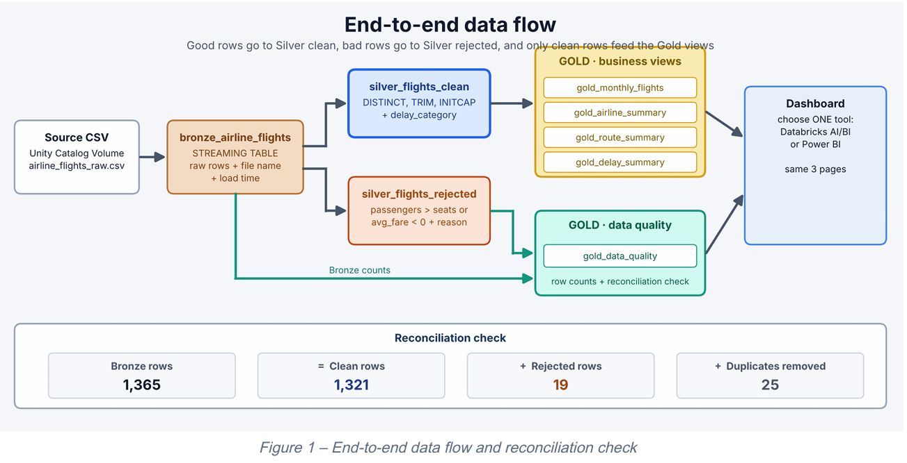
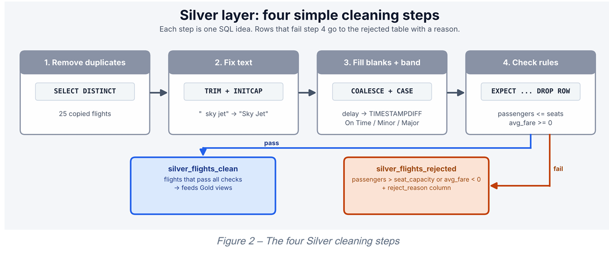

# Airline Flight Operations Analytics | End-to-End Data Engineering Project

An end-to-end **Databricks Data Engineering** project that transforms a raw airline-flight CSV into trusted analytics datasets using **Unity Catalog, Lakeflow Spark Declarative Pipelines, Databricks SQL, Medallion Architecture, and Databricks AI/BI Dashboards**.

> **Project status:** Bronze, Silver, and Gold layers completed and validated. A three-page Databricks AI/BI dashboard has been generated.

---

## Table of Contents

- [Business Problem](#business-problem)
- [Project Objectives](#project-objectives)
- [Dataset Overview](#dataset-overview)
- [Architecture](#architecture)
- [Databricks Environment](#databricks-environment)
- [Medallion Architecture](#medallion-architecture)
- [Data Cleaning and Business Rules](#data-cleaning-and-business-rules)
- [Gold Analytics Views](#gold-analytics-views)
- [Data Quality and Reconciliation](#data-quality-and-reconciliation)
- [Dashboard](#dashboard)
- [Key Results and Insights](#key-results-and-insights)
- [Repository Structure](#repository-structure)
- [How to Run](#how-to-run)
- [Limitations](#limitations)
- [Future Enhancements](#future-enhancements)

---

## Business Problem

Airline operations teams need consistent reporting on flight volume, passenger activity, ticket revenue, seat utilization, routes, and departure delays. Raw operational exports can contain duplicate flight records, inconsistent text formatting, missing values, invalid passenger counts, and negative fares.

This project builds a repeatable data pipeline that preserves the raw source, cleans and validates records, creates business-ready summary views, and presents the results in an interactive dashboard.

## Project Objectives

1. Ingest the source CSV from a Databricks Unity Catalog Volume.
2. Preserve source data in a Bronze streaming table.
3. Deduplicate and standardize records in Silver.
4. Separate invalid records into a rejected dataset with rejection reasons.
5. Create Gold materialized views for monthly, airline, route, delay, and data-quality analysis.
6. Reconcile the source records against clean, rejected, and duplicate records.
7. Build a three-page Databricks AI/BI dashboard.

## Dataset Overview

The reference specification describes a **synthetic learning dataset** containing 1,365 rows and 20 source columns for domestic flights during 2025. Airline names and flight records are fictional; this is not a live airline feed.

The dataset includes:

- Flight identifiers: `flight_id`, `flight_number`
- Airline and aircraft: `airline`, `aircraft_id`, `aircraft_type`
- Date and route: `flight_date`, `day_of_week`, `origin_city`, `destination_city`, `origin_region`, `distance_km`
- Departure and delay: `scheduled_departure`, `actual_departure`, `delay_minutes`, `delay_reason`
- Capacity and financials: `seat_capacity`, `passengers`, `avg_fare`, `ticket_revenue`, `fuel_cost`

The source CSV is not committed in this repository. Upload your own copy to the Unity Catalog Volume described below.

## Architecture



The pipeline follows the Medallion pattern:

**CSV in Unity Catalog Volume → Bronze → Silver Clean / Silver Rejected → Gold Materialized Views → Databricks AI/BI Dashboard**

A separate Gold data-quality view measures record counts and reconciliation.

## Databricks Environment

| Setting | Value |
|---|---|
| Platform | Databricks Free Edition |
| Catalog | `airline_flight_operations` |
| Schema | `default` |
| Volume | `airline_schema` |
| Source file | `airline_flights_raw.csv` |
| Volume path | `/Volumes/airline_flight_operations/default/airline_schema/airline_flights_raw.csv` |
| Pipeline technology | Lakeflow Spark Declarative Pipelines |
| Language | Databricks SQL |
| Dashboard | Databricks AI/BI |

> If you use a different workspace, update the catalog, schema, and Volume path in the SQL before running the pipeline.

## Medallion Architecture

### 1. Bronze Layer — Raw Ingestion

**Table:** `bronze_airline_flights`

The Bronze layer reads CSV files from the Unity Catalog Volume using Auto Loader through `read_files()` and a streaming table.

Additional metadata columns:

- `source_file` — source file name
- `loaded_at` — ingestion timestamp
- `_rescued_data` — rescued data field produced by ingestion

The Bronze layer retains the raw records so that downstream cleaning does not destroy source-level traceability.

### 2. Silver Layer — Cleaning and Validation

**Clean view:** `silver_flights_clean`  
**Rejected view:** `silver_flights_rejected`

The Silver transformation:

- Deduplicates by `flight_id`, retaining the latest ingested record.
- Trims whitespace and standardizes text using `TRIM()` and `INITCAP()`.
- Converts missing airline and other selected text values to `Unknown`.
- Normalizes delay-reason placeholders such as `None`, `none`, `NONE`, SQL `NULL`, and blanks to `Unknown`.
- Derives missing delay minutes from scheduled and actual departure timestamps using `TIMESTAMPDIFF`.
- Derives missing ticket revenue as `passengers * avg_fare`.
- Adds a `delay_category`.
- Sends records violating business rules to the rejected view with a `reject_reason`.

#### Delay categories

| Condition | Category |
|---|---|
| Delay is 15 minutes or less, including early departures | On Time |
| Delay is 16–60 minutes | Minor Delay |
| Delay is greater than 60 minutes | Major Delay |
| Delay is unavailable | Unknown |

#### Rejection rules

- `passengers > seat_capacity`
- `passengers < 0`
- `avg_fare < 0`

A negative delay is not treated as invalid: it represents an early departure and is classified as On Time.



### 3. Gold Layer — Business Analytics

Five materialized views are built from the validated Silver data:

| Gold view | Purpose |
|---|---|
| `gold_monthly_flights` | Monthly flight, passenger, revenue, fuel-cost, fare, delay, and on-time KPIs |
| `gold_airline_summary` | Airline-level flight volume, revenue, delay, on-time rate, and seat occupancy |
| `gold_route_summary` | Origin-destination route performance and revenue |
| `gold_delay_summary` | Flight counts and passenger/revenue metrics by delay category and reason |
| `gold_data_quality` | Bronze-to-Silver reconciliation and data-quality metrics |

## Data Cleaning and Business Rules

| Data issue | Transformation |
|---|---|
| Duplicate `flight_id` | Keep one record using `ROW_NUMBER()` |
| Extra spaces | Apply `TRIM()` |
| Inconsistent capitalization | Apply `INITCAP()` |
| Missing or placeholder delay reason | Standardize to `Unknown` |
| Missing delay minutes | Calculate from departure timestamps when available |
| Missing ticket revenue | Calculate passengers multiplied by average fare |
| Passengers greater than seat capacity | Reject record |
| Negative passenger count | Reject record |
| Negative average fare | Reject record |

The Silver cleaning design is based on the project reference document, with additional placeholder normalization applied after profiling the actual source values.

## Gold Analytics Views

### Monthly Flight Summary
Groups flights by month and calculates flight volume, passengers, revenue, fuel cost, average fare, average delay, delay-category counts, and on-time percentage.

### Airline Performance
Compares airlines using flight volume, passenger count, seat capacity, revenue, fuel cost, average fare, average delay, on-time percentage, and seat occupancy.

### Route Performance
Aggregates performance by origin city, destination city, and origin region, including revenue, fuel cost, distance, delay, and on-time percentage.

### Delay Analysis
Breaks down flight counts, delay duration, passenger totals, revenue, and delayed-flight counts by delay category and delay reason.

### Data Quality
Tracks raw record counts, duplicate counts, clean and rejected counts, overlapping records, missing fields, rescued data, rejection reasons, and reconciliation status.

## Data Quality and Reconciliation

The completed pipeline was validated with these results:

| Metric | Validated result |
|---|---:|
| Bronze rows | 1,365 |
| Distinct flight IDs in Bronze | 1,340 |
| Duplicate rows | 25 |
| Silver clean rows | 1,321 |
| Silver rejected rows | 19 |
| Clean/rejected overlap | 0 |
| Reconciliation difference | 0 |
| Reconciliation status | **PASS** |

Reconciliation formula:

```text
Bronze rows = Silver clean rows + Silver rejected rows + duplicate rows

1,365 = 1,321 + 19 + 25
```

Rejected record breakdown:

| Rejection reason | Records |
|---|---:|
| Overbooked passengers | 11 |
| Negative average fare | 8 |
| Negative passengers | 0 |
| **Total rejected** | **19** |

The cleaned Silver delay-reason distribution is:

| Delay reason | Records |
|---|---:|
| Unknown | 905 |
| Weather | 108 |
| Air Traffic | 104 |
| Technical | 88 |
| Late Arrival | 73 |
| Crew | 43 |
| **Total** | **1,321** |

## Dashboard

The final dashboard was created in Databricks AI/BI using the five Gold views as datasets.


### Page 1 — Executive Overview

- Total flights
- Total passengers
- Total ticket revenue
- Average delay
- On-time percentage
- Monthly flight trend
- Monthly revenue trend
- Monthly passenger trend
- Flight status distribution by month
- Airline contribution to flight volume

### Page 2 — Airline & Route Performance

- Total airlines, flights, passengers, revenue, and seat occupancy
- Flights by airline
- On-time performance by airline
- Seat occupancy by airline
- Airline revenue comparison
- Top 10 routes by revenue
- Top 10 routes by flight volume
- Route performance details

### Page 3 — Flight Delays & Data Quality

- Major, minor, and on-time flight counts
- Rejected records and reconciliation status
- Flights by delay category
- Delay reasons among delayed flights
- Average delay by reason
- Delay category versus delay reason
- Delayed passengers by category
- Bronze versus Silver record counts
- Missing-data metrics
- Rejected-record breakdown

Dashboard screenshots from the live Databricks workspace can be added to `assets/dashboard/` when available.

## Key Results and Insights

Based on the validated Gold outputs:

- **1,321** valid flights are available for business analysis.
- **902** flights are classified as On Time.
- **284** flights are classified as Minor Delay.
- **135** flights are classified as Major Delay.
- Sky Jet has the highest flight volume with **385 flights**.
- Fly Easy has the highest on-time percentage at **71.51%**.
- The pipeline accounts for every Bronze row through clean, rejected, and duplicate categories.
- Data reconciliation completed with **PASS** and a difference of zero.

These results describe the synthetic learning dataset and should not be interpreted as real-world airline performance.

## Repository Structure

```text
Airline_Flight_Operations_Data_Engineering/
│
├── README.md
├── docs/
│   └── Airline_Flight_Operations_Project_Reference.pdf
│
├── data/
│   └── README.md
│
├── assets/
│   ├── architecture/
│   │   ├── medallion_architecture_and_reconciliation.png
│   │   └── silver_cleaning_steps.png
│   └── dashboard/
│       └── dashboard_reference_example.png
│
├── Airline_Bronze_Layer/
│   └── Bronze_Airline_Flights/
│       └── transformations/
│           └── Bronze_transformation.sql
│
├── Airline_Silver_Layer/
│   └── Silver_Airline_Flights/
│       └── transformations/
│           └── Silver_transformation.sql
│
└── Airline_Gold_Layer/
    └── Gold_Airline_Flights/
        └── transformations/
            └── Gold_transformation.sql
```

## How to Run

1. Create or select the Unity Catalog catalog and schema.
2. Create a Unity Catalog Volume named `airline_schema`.
3. Upload `airline_flights_raw.csv` into the Volume.
4. Update the source path and catalog/schema references in the SQL if your environment differs.
5. Create a Lakeflow Spark Declarative Pipeline and add the Bronze, Silver, and Gold SQL transformation files.
6. Run the pipeline and confirm all eight tables/views exist.
7. Validate the row counts and reconciliation status in `gold_data_quality`.
8. Create a Databricks AI/BI dashboard and add the five Gold views as datasets.
9. Build the three dashboard pages and publish the dashboard.

### Validation query

```sql
SELECT *
FROM airline_flight_operations.default.gold_data_quality;
```

### List project tables and views

```sql
SHOW TABLES IN airline_flight_operations.default;
```

## Limitations

- The input is a synthetic, static 2025 dataset.
- This project does not implement real-time flight tracking.
- Arrival delays, cancellations, connecting flights, and external airline systems are outside scope.
- No real passenger personal information is used.
- Advanced dimensional modelling, SCD processing, and production alerting are not implemented.

## Future Enhancements

- Add incremental ingestion monitoring and pipeline failure alerts.
- Add date, airline, and route dimensions for more advanced analytics.
- Add historical trend comparisons when additional years of data are available.
- Add automated data-quality tests and pipeline run monitoring.
- Add dashboard refresh scheduling and usage monitoring.

---

## Project Takeaway

This project demonstrates how a raw operational CSV can be transformed into trusted business analytics through a structured data engineering workflow:

**Bronze preserves the data → Silver improves data quality → Gold delivers business metrics → AI/BI communicates insights.**

