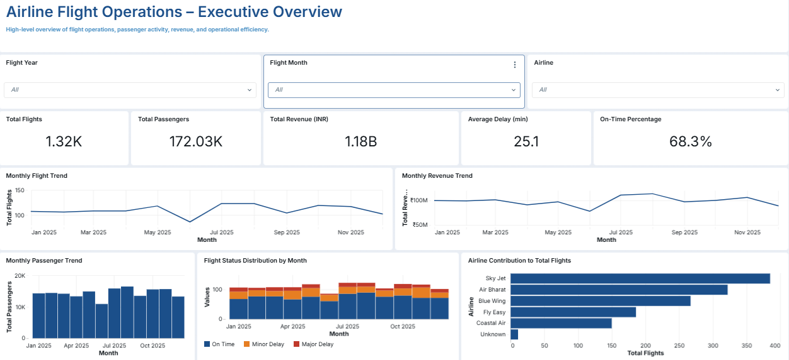
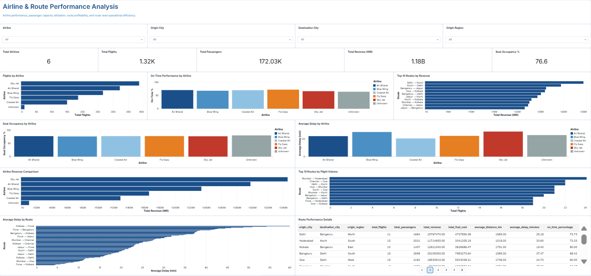
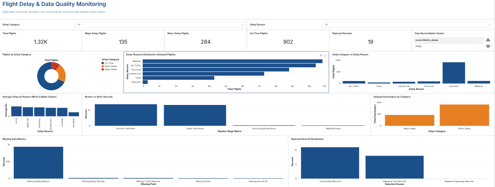

# Airline Flight Operations Analytics: End-to-End Data Engineering Project

An end-to-end airline flight operations data engineering project built on **Azure Databricks Free Edition**, using **Lakeflow Spark Declarative Pipelines (SQL)** and the **Medallion Architecture (Bronze → Silver → Gold)**.

This project transforms raw airline flight data into trusted, business-ready analytical datasets through automated ingestion, data cleaning, deduplication, validation, business aggregations, and data-quality reconciliation. The Gold layer powers a three-page **Databricks AI/BI Dashboard** for airline performance, route analysis, flight delays, and data quality monitoring.

---

## Table of Contents

- [Business Problem](#business-problem)
- [Project Objectives](#project-objectives)
- [Architecture](#architecture)
- [Pipeline Lineage](#pipeline-lineage)
- [Tech Stack](#tech-stack)
- [Dataset](#dataset)
- [Repository Structure](#repository-structure)
- [Layer Details](#layer-details)
- [Data Quality Rules](#data-quality-rules)
- [Reconciliation](#reconciliation)
- [Gold Business Analytics](#gold-business-analytics)
- [Dashboard](#dashboard)
- [How to Run](#how-to-run)
- [Business Requirements Coverage](#business-requirements-coverage)
- [Key Learnings](#key-learnings)
- [Future Improvements](#future-improvements)
- [License](#license)

---

## Business Problem

Airline operations generate large volumes of flight-related data, including flight schedules, departure information, passenger counts, ticket revenue, fuel costs, and delay reasons.

However, raw operational data may contain duplicate flight records, missing values, inconsistent text formatting, and invalid business values. These issues can affect reporting accuracy and make it difficult for airline management to understand operational performance.

Manual data cleaning and reporting are difficult to maintain and are not easily repeatable.

**Goal:** Build a managed, repeatable data engineering pipeline that preserves raw airline data, standardizes and validates records, separates invalid records, and publishes trusted Gold datasets for operational and business analytics.

## Project Objectives

- Ingest raw airline flight data into Databricks using Auto Loader.
- Implement the Medallion Architecture using Lakeflow Spark Declarative Pipelines.
- Preserve raw source data and ingestion metadata in Bronze.
- Clean, standardize, and deduplicate records in Silver.
- Separate rejected records using business validation rules.
- Build business-ready Gold materialized views.
- Track missing values, duplicates, rejected records, and reconciliation.
- Develop a three-page Databricks AI/BI Dashboard.
- Generate actionable insights into airline operations and flight performance.

## Architecture

**Source CSV → Bronze → Silver → Gold → AI/BI Dashboard**


| Layer | Purpose | Key Actions |
|---|---|---|
| Bronze | Preserve source data | CSV ingestion, Auto Loader, source metadata |
| Silver | Improve data quality | Deduplication, standardization, validation, clean and rejected records |
| Gold | Support business analytics | Monthly summaries, airline performance, route performance, delay analysis, data quality |

## Pipeline Lineage


| Object | Type | Description |
|---|---|---|
| `bronze_airline_flights` | Streaming Table | Raw airline flight records ingested using Auto Loader |
| `silver_flights_clean` | Materialized View | Deduplicated, standardized, and validated flight records |
| `silver_flights_rejected` | Materialized View | Records rejected by business validation rules |
| `gold_monthly_flights` | Materialized View | Monthly flight, passenger, revenue, and delay KPIs |
| `gold_airline_summary` | Materialized View | Airline-wise operational performance |
| `gold_route_summary` | Materialized View | Origin-destination route performance |
| `gold_delay_summary` | Materialized View | Delay category and delay reason analysis |
| `gold_data_quality` | Materialized View | Bronze-to-Silver reconciliation and data-quality metrics |

## Tech Stack

- **Cloud Platform:** Azure Databricks Free Edition
- **Data Engineering:** Lakeflow Spark Declarative Pipelines
- **Programming Language:** SQL
- **Data Architecture:** Medallion Architecture
- **Data Ingestion:** Databricks Auto Loader
- **Storage Format:** Delta Lake
- **Data Governance:** Unity Catalog
- **Data Storage:** Unity Catalog Volumes
- **Analytics:** Databricks SQL
- **Visualization:** Databricks AI/BI Dashboards
- **Version Control:** Git and GitHub

## Dataset

**Dataset:** `airline_flights_raw.csv`

The source dataset contains airline flight operational information, including:

| Column | Description |
|---|---|
| `flight_id` | Unique flight identifier |
| `flight_number` | Airline flight number |
| `airline` | Airline name |
| `aircraft_id` | Aircraft identifier |
| `aircraft_type` | Aircraft model or type |
| `flight_date` | Date of the flight |
| `day_of_week` | Day of the flight |
| `origin_city` | Departure city |
| `destination_city` | Arrival city |
| `origin_region` | Origin geographical region |
| `distance_km` | Flight distance in kilometers |
| `scheduled_departure` | Scheduled departure timestamp |
| `actual_departure` | Actual departure timestamp |
| `delay_minutes` | Flight delay in minutes |
| `delay_reason` | Reason for flight delay |
| `seat_capacity` | Total aircraft seating capacity |
| `passengers` | Number of passengers |
| `avg_fare` | Average ticket fare |
| `ticket_revenue` | Total ticket revenue |
| `fuel_cost` | Flight fuel cost |

**Source File:** `airline_flights_raw.csv`

**Source Location:** Unity Catalog Volume

```text
/Volumes/airline_flight_operations/default/airline_schema/
```

**Initial Bronze Records:** 1,365

## Repository Structure

```text
Airline_Flight_Operations/
│
├── Airline_Bronze_Layer/
│   └── Bronze_Airline_Flights/
│       └── transformations/
│           └── Bronze_transformation.sql
│
├── Airline_Silver_Layer/
│   └── Silver_Airline_Flights/
│       └── transformations/
│           └── Silver_transformation.sql
│
├── Airline_Gold_Layer/
│   └── Gold_Airline_Flights/
│       └── transformations/
│           └── Gold_transformation.sql
│
├── images/
│   ├── architecture.png
│   ├── medallion_architecture.png
│   ├── pipeline_lineage.png
│   ├── dashboard_overview.png
│   ├── airline_performance.png
│   └── flight_delays_quality.png
│
└── README.md
```

## Layer Details

### 1. Bronze Layer – Raw Data Ingestion

**Table:** `bronze_airline_flights`

The Bronze layer ingests raw airline flight records from the Unity Catalog Volume using Databricks Auto Loader.

**Operations performed:**

- CSV ingestion using `read_files()`.
- Streaming ingestion using `STREAM`.
- Preserve all source columns.
- Capture source filename using `_metadata.file_name`.
- Capture ingestion timestamp using `current_timestamp()`.

**Additional Columns:**

| Column | Description |
|---|---|
| `source_file` | Original source filename |
| `loaded_at` | Timestamp when the record was ingested |

**Bronze Record Count:** 1,365

### 2. Silver Layer – Data Cleaning and Validation

The Silver layer transforms raw Bronze records into clean and rejected datasets.

**Clean Table:** `silver_flights_clean`

**Rejected Table:** `silver_flights_rejected`

**Operations performed:**

- Remove duplicate flight records using `ROW_NUMBER()`.
- Standardize text using `TRIM()` and `INITCAP()`.
- Handle missing and placeholder values.
- Derive delay minutes when missing and departure timestamps are available.
- Derive ticket revenue when missing and passenger and fare values are available.
- Categorize flight delays.
- Apply business validation rules.
- Separate invalid records into the rejected dataset.

**Delay Categorization:**

| Delay Condition | Category |
|---|---|
| Delay ≤ 15 minutes | On Time |
| Delay > 15 and ≤ 60 minutes | Minor Delay |
| Delay > 60 minutes | Major Delay |

**Silver Output:**

| Dataset | Records |
|---|---:|
| Clean Records | 1,321 |
| Rejected Records | 19 |
| Duplicate Records Removed | 25 |

### 3. Gold Layer – Business Aggregation

The Gold layer contains five materialized views created from Silver and Bronze datasets.

| Gold View | Business Purpose |
|---|---|
| `gold_monthly_flights` | Monthly flight trends, passenger volume, revenue, fuel costs, and delay KPIs |
| `gold_airline_summary` | Airline performance, occupancy, revenue, and on-time percentage |
| `gold_route_summary` | Route-level flight volume, passenger traffic, revenue, and delays |
| `gold_delay_summary` | Delay severity and delay reason analysis |
| `gold_data_quality` | Data quality metrics, rejected records, duplicates, and reconciliation |

These views provide structured datasets for reporting and business decision-making.

## Data Quality Rules

The Silver layer applies the following business validation rules:

| Rule | Condition | Action |
|---|---|---|
| Flight ID Validation | `flight_id IS NULL` | Reject invalid record |
| Duplicate Validation | Duplicate `flight_id` | Keep the latest record |
| Passenger Validation | `passengers < 0` | Reject record |
| Capacity Validation | `passengers > seat_capacity` | Reject record |
| Fare Validation | `avg_fare < 0` | Reject record |
| Text Standardization | Leading/trailing spaces and inconsistent casing | Standardize values |
| Missing Delay Reason | NULL, blank, `None`, or `null` | Replace with `Unknown` |
| Missing Delay Minutes | Available departure timestamps | Derive delay duration |
| Missing Ticket Revenue | Available passenger count and average fare | Derive ticket revenue |

## Reconciliation

The project validates record counts between Bronze and Silver to ensure that records are correctly classified.

**Reconciliation Formula:**

```text
Bronze Total = Clean Records + Rejected Records + Duplicate Records
```

**Actual Reconciliation:**

```text
1,365 = 1,321 + 19 + 25
```

| Metric | Count |
|---|---:|
| Bronze Total Rows | 1,365 |
| Bronze Unique Flights | 1,340 |
| Bronze Duplicate Rows | 25 |
| Silver Clean Records | 1,321 |
| Silver Rejected Records | 19 |
| Overlapping Records | 0 |
| Reconciliation Difference | 0 |

<details>
<summary><strong>Data Quality Validation Results</strong></summary>

| Quality Metric | Count |
|---|---:|
| Missing Airline | 11 |
| Missing Aircraft ID | 9 |
| Missing Delay Minutes | 18 |
| Missing Delay Reason | 936 |
| Missing Ticket Revenue | 16 |
| Rescued Data Rows | 0 |
| Overbooked Records | 11 |
| Negative Passenger Records | 0 |
| Negative Fare Records | 8 |

</details>

**Reconciliation Status: PASS**

The reconciliation confirms that all 1,365 Bronze records are accounted for as clean records, rejected records, or duplicates.

## Gold Business Analytics

The Gold layer supports the following analytical requirements:

### Monthly Flight Analysis

- Total flights by month.
- Passenger volume trends.
- Monthly ticket revenue and fuel costs.
- Average delay minutes.
- Monthly on-time performance.

### Airline Performance Analysis

- Flight volume by airline.
- Total passengers and seat capacity.
- Seat occupancy percentage.
- Total ticket revenue.
- Average delay minutes.
- On-time performance comparison.

### Route Performance Analysis

- Flight volume by origin and destination.
- Passenger traffic across routes.
- Route-level revenue.
- Average flight distance.
- Average delay and on-time percentage.

### Flight Delay Analysis

- On-time, minor-delay, and major-delay distribution.
- Delay reasons by severity.
- Average and maximum delay duration.
- Passenger impact of delayed flights.

### Data Quality Monitoring

- Bronze, clean, rejected, and duplicate record counts.
- Missing-value metrics.
- Invalid passenger and fare records.
- Bronze-to-Silver reconciliation status.

## Dashboard

The project includes a three-page Databricks AI/BI Dashboard built using Gold materialized views.

### Page 1 – Executive Overview



Provides a high-level view of airline operations, monthly flight trends, revenue, flight status distribution, and airline revenue contribution.

### Page 2 – Airline & Route Performance



Analyzes airline operational performance, route-level delay patterns, distance versus delay relationships, and airline comparison metrics.

### Page 3 – Flight Delays & Data Quality



Highlights delay severity, delay reasons, rejected records, duplicate records, and Bronze-to-Silver reconciliation.

## How to Run

### Step 1 – Create Unity Catalog Resources

Create the catalog, schema, and volume in Databricks.

```sql
CREATE CATALOG IF NOT EXISTS airline_flight_operations;

CREATE SCHEMA IF NOT EXISTS
airline_flight_operations.default;

CREATE VOLUME IF NOT EXISTS
airline_flight_operations.default.airline_schema;
```

### Step 2 – Upload Source Dataset

Upload `airline_flights_raw.csv` into:

```text
/Volumes/airline_flight_operations/default/airline_schema/
```

### Step 3 – Create Bronze Pipeline

- Create a Lakeflow Spark Declarative Pipeline.
- Add `Bronze_transformation.sql`.
- Configure the pipeline to use the appropriate catalog and schema.
- Run the pipeline.
- Verify `bronze_airline_flights`.

### Step 4 – Create Silver Pipeline

- Add `Silver_transformation.sql`.
- Configure the pipeline to use the Bronze source.
- Run the pipeline.
- Verify `silver_flights_clean` and `silver_flights_rejected`.

### Step 5 – Create Gold Pipeline

- Add `Gold_transformation.sql`.
- Configure the pipeline to use the existing Silver and Bronze datasets.
- Run the pipeline.
- Verify all five Gold materialized views.

### Step 6 – Validate Data Quality

Run validation queries to verify:

- Bronze record counts.
- Clean and rejected record counts.
- Duplicate records.
- Data quality metrics.
- Reconciliation status.

### Step 7 – Build AI/BI Dashboard

Use the Gold materialized views as dashboard datasets and create the three analytical pages.

## Business Requirements Coverage

| Business Requirement | Implemented Solution |
|---|---|
| Raw flight data ingestion | Bronze streaming table using Auto Loader |
| Duplicate management | Latest-record selection using `ROW_NUMBER()` |
| Data standardization | Silver transformations |
| Invalid record handling | Separate rejected dataset |
| Flight delay categorization | On Time, Minor Delay, Major Delay |
| Monthly operational reporting | `gold_monthly_flights` |
| Airline performance reporting | `gold_airline_summary` |
| Route analysis | `gold_route_summary` |
| Delay analysis | `gold_delay_summary` |
| Data quality monitoring | `gold_data_quality` |
| Data reconciliation | Bronze-to-Silver record reconciliation |
| Business visualization | Three-page AI/BI Dashboard |

## Key Learnings

- Implementing Medallion Architecture in Azure Databricks.
- Using Auto Loader for incremental file ingestion.
- Building streaming tables and materialized views with SQL.
- Managing data assets using Unity Catalog.
- Implementing deduplication and data validation.
- Handling missing values and inconsistent source data.
- Designing separate clean and rejected datasets.
- Building business-oriented Gold analytical views.
- Implementing data-quality reconciliation.
- Translating operational data into business insights through dashboards.

## Future Improvements

- Integrate additional airline operational datasets.
- Implement incremental processing for larger datasets.
- Add flight cancellation and aircraft utilization analytics.
- Introduce predictive flight delay models.
- Implement automated pipeline monitoring and alerting.
- Add historical trend analysis and advanced performance metrics.
- Integrate Power BI for additional reporting capabilities.

## License

This project is developed for educational and portfolio purposes.

The dataset is used for learning, data engineering practice, and analytics demonstration. Refer to the original dataset provider for applicable usage and licensing terms.

---

**Author:** Prasanna Panchumarthi

**GitHub:** [prasanna464](https://github.com/prasanna464)

**LinkedIn:** [Prasanna Panchumarthi](https://www.linkedin.com/in/prasanna-panchumarthi/)
